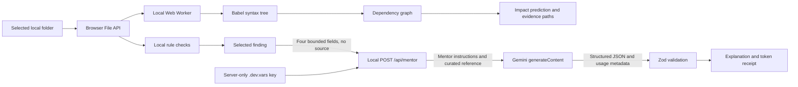

# Catalyst: architecture, AI usage, and demonstration guide

Prepared on 8 October 2026 for the current local prototype.

## The project in one minute

“Catalyst is an educational development mentor. It combines deterministic checks on a real project, an interactive dependency-learning lab, and Gemini explanations. The checks identify evidence, the Impact Lab helps the learner reason about changes, and Gemini explains the underlying concepts. Source files stay on the learner’s device. The AI does not execute or edit code.”

The new **Change Impact Lab** asks: *If I change this file, which other modules could be affected?* Learners can explore the answer or predict a count before revealing the real dependency paths. This is an additional teaching interaction, not another AI-generated list of fixes.

## Technology actually used

| Layer | Implementation | Why it is used |
| --- | --- | --- |
| UI | React 19.2.6, TypeScript 5.9.3 | Components, state, typed data contracts |
| App framework | Next.js App Router conventions, running through Vinext 1.0.0-beta.5 and Vite 8.0.13 | Page/layout rendering and development/build pipeline; this project does not run a conventional Next server |
| Styling | Tailwind CSS 4.2.1, custom CSS design tokens, shadcn/Base UI button | Responsive charcoal, cool off-white, and violet interface; custom Catalyst orbit logo, locally hosted Space Grotesk and Manrope fonts, and animated bubble navigation |
| Visual components | Lucide icons; React Bits LatticeLoader and Particles; OGL 1.0.11 | Request progress and decorative WebGL background |
| Folder import | Browser File API and directory input | Reads a user-selected folder into browser memory |
| Project review | Local TypeScript heuristics | Detects evidence such as missing test files, unbounded versions, and possible embedded credentials |
| Impact Lab | Babel parser, browser Web Worker, directed dependency graph | Parses JS/TS syntax locally, resolves imports, and keeps parsing off the UI thread |
| Graph algorithms | Reverse-edge breadth-first search; Tarjan strongly connected components | Finds reachable importers with shortest evidence paths; detects cyclic groups |
| Backend | TypeScript Cloudflare Worker entry point in `build/sites-worker.ts`; server adapter in `lib/server/mentor.mjs` | Handles `/api/mentor`, keeps the API key server-side, validates requests, calls Gemini |
| Local backend runtime | Wrangler/Miniflare through Cloudflare’s Vite plugin | Runs the Worker locally; Node.js is the development/build tooling runtime |
| Validation | Zod plus Gemini JSON response schema | Rejects unsupported inputs and malformed model responses |
| AI | Google Gemini REST `generateContent`; configured model `gemini-3.5-flash-lite` | Produces short educational explanations on demand |
| Tests | Node.js built-in test runner and TypeScript checks | Tests import, analysis, graph traversal, and provider protocol behavior |
| Storage | React/browser memory during the open session | Project files, findings, learning marks, and review history; no persistent project database |

The repository also contains starter packages for Drizzle, charts, and connector infrastructure. These are **not** an implemented database, authentication service, or analytics system for Catalyst. D1 and R2 bindings are unset. There is no Express backend, Python backend, vector database, custom-trained model, or automatic code execution.

## End-to-end flow

### What the new feature computes

1. Parse supported JS/TS source into an abstract syntax tree. Comments and text that merely resembles an import do not create links.
2. Extract static imports, re-exports, literal dynamic imports, CommonJS `require` calls, and type imports.
3. Resolve relative paths, extension/index conventions, and explicit `paths`/`baseUrl` settings in the closest `tsconfig.json` or `jsconfig.json`.
4. Create an edge **A → B** when source module A imports B.
5. On selection of B, traverse reverse edges to find its direct and indirect importers. Count each file once, even if multiple paths or cycles reach it. Display a shortest evidence path.
6. Find strongly connected components to identify cyclic groups. A cycle does not itself prove a defect.
7. In prediction mode, compare the learner’s submitted count against this actual graph. Export paths as Markdown if needed.

This feature uses **zero Gemini requests and zero Gemini tokens**. It never modifies or runs imported code. A dependency means “review this module when changing its dependency,” not “this module will definitely break.”

Coverage limits are visible in the UI: Python graphs, computed import paths, framework routing, package exports, asset imports, and inherited configuration are not resolved. External/unmapped bare imports are counted separately. Syntax failures and unresolved local imports are disclosed. Type-only links are included because changing a type can affect compilation. A shadowed local function named `require` can be mistaken for a module call. It is a bounded static dependency view, not a complete compiler or runtime simulation.

## How the Gemini key works

The key is an authentication credential associated with a Google Cloud project. Requests use that project’s access, quota, and billing configuration. It is not a token balance, and it does not train a model.

1. The developer puts `GEMINI_API_KEY` and optionally `GEMINI_MODEL` into the ignored `.dev.vars` file on the server machine.
2. Wrangler supplies those values as Worker environment bindings. They are not bundled into the frontend.
3. A user presses **Explain with AI**, **Suggest a next step**, or **Check my understanding**.
4. The browser sends exactly `findingId`, `language`, `stage`, and `intent` to the same-origin `/api/mentor` endpoint.
5. The server validates those fields, checks its local usage limits, and chooses the relevant curated reference summary.
6. The server calls `https://generativelanguage.googleapis.com/v1beta/models/{model}:generateContent`, placing the key in the `x-goog-api-key` HTTP header.
7. Gemini returns structured fields: `explanation`, `nextStep`, and `checkYourUnderstanding`. The server validates them and returns the answer, server-selected reference, model name, and sanitized usage counters.

No source content, file paths, project name, detected credential value, or arbitrary user prompt is transmitted. The model only knows the finding category and limited educational context. **Key loaded** checks configuration presence; a successful **LIVE RESPONSE** proves that a provider request actually worked.

Keep `.dev.vars` private. Do not show it during the presentation. Because a key was previously shared in this conversation, replace that exposed key in Google AI Studio and update the local file before broader use. Google recommends server-side calls and keeping keys out of source control: [API key guidance](https://ai.google.dev/gemini-api/docs/api-key).

## Actual Gemini token consumption

A token is a model processing unit, not necessarily a whole word. Input includes the mentor instruction, finding context, curated reference, and applicable request/schema overhead. Output covers generated response content. Thinking-capable models can report additional thinking tokens. Counts vary with the request and generated response.

The app now displays **This response** usage directly from Gemini’s `usageMetadata`:

| UI field | Provider field |
| --- | --- |
| Input | `promptTokenCount` |
| Output | `candidatesTokenCount` |
| Thinking | `thoughtsTokenCount` |
| Cached input, when reported | `cachedContentTokenCount` |
| Total | `totalTokenCount` |

Missing fields display “—”, not an invented zero. Cached input is a subset of input, not an extra amount to add. Google defines total as prompt + thoughts + response candidate tokens. See [GenerateContent usage metadata](https://ai.google.dev/api/generate-content#UsageMetadata).

### Measured example from this implementation

A real successful “Explain with AI” request for the environment-file finding on 8 October 2026 reported:

- Model: `gemini-3.5-flash-lite`
- Input: **205 tokens**
- Output: **170 tokens**
- Total: **375 tokens**
- Thinking: not separately reported
- Elapsed time shown in the browser: **9.1 seconds**

This is one observed request, not a promise that every request uses 375 tokens. The UI shows the actual counts for each new successful answer. Folder import, local review, Impact Lab, prediction, filtering, history comparison, report export, animations, and configuration checks consume **0 Gemini tokens**.

Each AI button click makes one provider request. There is no automatic retry, no conversation history replay, and no explicit context-cache setup. The model is instructed to keep the answer below 250 words. `maxOutputTokens: 4096` is a generation ceiling, **not** a charge of 4,096 tokens on every click. The configured Flash-Lite model uses `thinkingLevel: MINIMAL`.

The receipt is not a billing ledger: older usage was not stored, and failed, cancelled, or rejected responses may not yield a receipt even if the provider did work. Account-wide totals and actual charges must be checked in Google AI Studio/Cloud billing.

## Cost and limits

Google’s published **standard paid-tier** rates for Gemini 3.5 Flash-Lite, checked on 8 October 2026, are **$0.30 per million input tokens** and **$2.50 per million output tokens, including thinking**. The pricing page also lists a free tier. This does not establish which tier your key uses. [Official pricing](https://ai.google.dev/gemini-api/docs/pricing#gemini-3.5-flash-lite).

For the measured example, assuming standard paid rates, no cached discount, and no additional reported thinking tokens:

`(205 × $0.30 + 170 × $2.50) / 1,000,000 = $0.0004865`

That is about **$0.00049 for this response**, or approximately **$0.49 for 1,000 identical-sized responses**. This is an illustrative calculation, not your actual invoice. Prices, tiers, and output lengths can change.

There are two separate limits:

- **Catalyst’s own prototype controls:** one request in flight and five request starts per minute per Worker instance; 45-second provider timeout; 4 KB incoming JSON body. These counters reset when the Worker restarts and are not durable production billing controls.
- **Google’s limits:** vary by model and project tier, including request and token quotas. Limits apply per Google project rather than per key. Check the project’s active limits in AI Studio; creating another key for the same project does not create a separate quota. [Official rate-limit documentation](https://ai.google.dev/gemini-api/docs/rate-limits).

The AI endpoint accepts only local loopback hosts and exact same-origin POST requests. Public hosting requires real authentication and durable per-user rate controls first. Changing a hostname alone is not a production security design.

## Five-minute demonstration

1. **30 seconds — purpose:** Explain “teach while building,” then import a real small JS/TS project’s root folder.
2. **45 seconds — evidence:** Show actual files and one rule finding. State that checks are heuristic and do not execute tests.
3. **90 seconds — new feature:** Open **Impact Lab**. Select a commonly imported utility. Ask your professor to predict the number of modules it can affect, use **Predict & reveal**, and trace one indirect import path. If a cyclic group exists, show it; do not promise that every project has cycles.
4. **60 seconds — AI:** Return to **Project review**, choose a finding, and press **Explain with AI**. Show the generated explanation, frozen loader timer, and actual token receipt. Explain what was sent and what stayed local.
5. **45 seconds — progress:** Explain or demonstrate changing code externally and using **Review changes**. Learning marks record understanding; re-imported evidence determines resolved findings.
6. **30 seconds — boundaries:** No custom model training, no source upload to Gemini, no database persistence, no automatic fixes. Future work: authenticated accounts, persistence, deeper language resolution, and measured learning outcomes.

Use a root folder with multiple JS/TS modules and real imports for the Impact Lab. Selecting only a subfolder limits the snapshot and may make references outside it unresolved. Start the server and test Gemini before the meeting. If internet/API access fails, the review and Impact Lab still work locally; do not substitute a canned AI answer.

## Likely questions from your professor

**What is your contribution beyond calling an API?** Local bounded import and evidence-based checks, dependency parsing/resolution, graph traversal, cyclic-group detection, prediction/reveal learning interaction, privacy boundary, schema validation, real usage reporting, and review comparison.

**Is the AI detecting the mistakes?** The current findings are deterministic heuristics. Gemini explains the selected finding using bounded context. The new dependency map comes from AST parsing and graph algorithms, not AI inference.

**Is this RAG?** It selects a curated reference by finding ID to ground generation. It is not semantic vector retrieval or live document search.

**Did you train Gemini?** No. The app calls a hosted pretrained model with a mentor instruction and structured response schema.

**Why not send the entire repository?** Keeping files local reduces disclosure and token usage. The tradeoff is that Gemini cannot inspect exact implementation details or produce code-specific diagnoses.

**Can it prove a change breaks the app?** No. Import reachability identifies files worth reviewing; actual failures require relevant compilation, tests, and runtime checks.

**Where is the database?** There is no persistent application database in this prototype. Browser memory stores the current session; reload clears it.

**Can multiple users use the hosted system today?** The current backend is deliberately local-only. Authentication, durable persistence, and distributed quotas remain future work.

## Learning plan and journal

The Learning plan tab turns actual imported findings into tasks. Students choose To learn, In progress, or Ready to review and write their own learning notes. Use Review updated project after editing: complete snapshots mark absent findings No longer detected; recurring findings reopen, keeping notes. Partial imports do not clear missing findings. This is heuristic evidence, not proof tests passed. Progress survives tab navigation and same-project comparisons, but resets when opening another project, closing it, or reloading. Export learning journal downloads the findings, stages, evidence paths, and user notes as Markdown. The feature runs locally and uses no Gemini tokens; Explore with mentor opens the existing review, where an explicit AI action uses Gemini.
